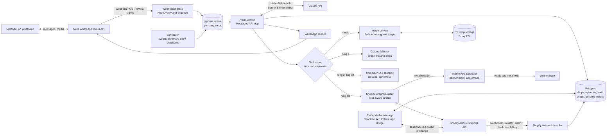
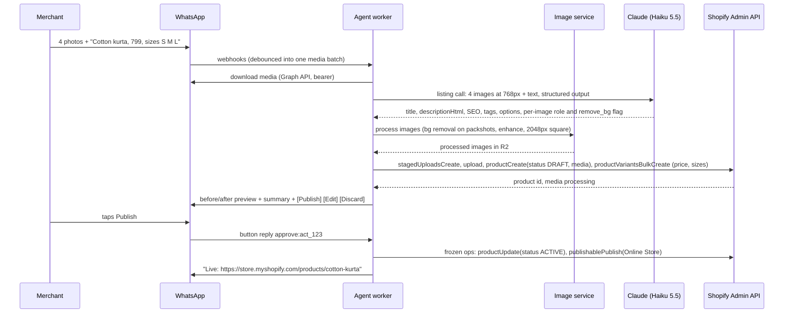
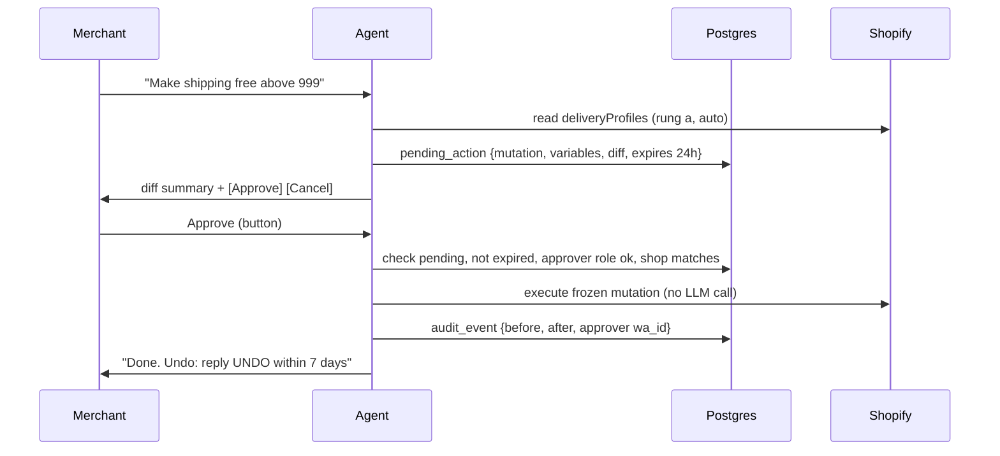

# 1. System Architecture

## 1.1 Component diagram

## 1.2 Request path: one merchant message

1. **Ingress** (`POST /webhooks/whatsapp`): verify `X-Hub-Signature-256` against the raw body. Dedupe on the
   WhatsApp message id. Store the raw payload. Enqueue a job with `singletonKey = shop_id`, so each merchant's
   messages are handled one at a time and in order. Return 200 within milliseconds.
2. **Identity**: map `wa_id` (the sender's phone) to a `merchant_user` and its `shop`. An unknown number
   gets the onboarding reply with an install link. No LLM is called.
3. **Pre-router (deterministic, no LLM)**:
   - Interactive button reply such as `approve:<action_id>` or `reject:<action_id>`: run or cancel the frozen
     pending action and reply with the result. This costs zero tokens.
   - An image or document message starts or extends a **media batch** with a 25-second debounce window.
     The agent runs once when the batch closes or a text message arrives, not once per photo.
   - `STOP`, `HELP` or `UNDO` keywords go to fixed handlers.
4. **Agent episode**: load the shop context (the cached merchant profile) and the open episode. Run the
   tool loop on Haiku 5.5 (doc 05). Tools go through the **tool router**, which enforces tiers:
   read and low-impact writes run straight away; high-impact and destructive writes become a
   `pending_action` with the exact GraphQL operation and variables frozen.
5. **Reply**: send text, image previews or approval buttons. Log usage and audit events.

## 1.3 Product creation sequence

## 1.4 Approval sequence (high-impact action)

## 1.5 Data model (Postgres)

| Table | Key columns | Notes |
|---|---|---|
| `shops` | id, shop_domain, offline_token_enc, refresh_token_enc, token_expires_at, plan, status, installed_at, uninstalled_at | Tokens encrypted with AES-256-GCM (envelope key in env/KMS). |
| `shopify_sessions` | Prisma session storage | Managed by `@shopify/shopify-app-session-storage-prisma`. |
| `merchant_users` | id, shop_id, wa_id, display_name, role (owner, staff), linked_at, revoked_at | One shop has many phones. Only owners approve tier C and D. |
| `link_codes` | code, shop_id, created_by, expires_at, used_at | wa.me linking, 10-minute expiry. |
| `wa_messages` | wa_message_id (unique), direction, shop_id, type, payload_json, status | Dedupe, delivery status, 90-day retention. |
| `media_batches` / `media_assets` | batch_id, shop_id, wa_media_id, r2_key, sha256, role, processed_key | Raw media deleted after 7 days. |
| `episodes` | id, shop_id, status, model, started_at, summary | One task-sized conversation. Closed after 30 minutes idle or when the task is done. |
| `episode_messages` | episode_id, seq, role, content_json | Stored exactly as sent to the API. Append-only. |
| `merchant_memory` | shop_id, key, value | Brand voice, default vendor, preferred language, notes. |
| `pending_actions` | id, shop_id, tier, tool, graphql_ops_json, diff_text, status, expires_at, approved_by | Frozen operations. Approval runs exactly these. |
| `audit_events` | id, shop_id, actor (agent, merchant, system), wa_id, tool, request_json, response_json, before_json, after_json, pending_action_id, created_at | Append-only. Shown in the embedded app. Source for UNDO. |
| `llm_usage` | id, shop_id, episode_id, purpose, model, input, cache_read, cache_write, output, cost_usd | Per-call metering. Budget checks run against it. |
| `budgets` | shop_id, period_start, llm_usd_limit, llm_usd_used, cu_tasks_used | Monthly, resets with the billing cycle. |
| `settings` | shop_id, approval_rules_json, quiet_hours, language, computer_use_enabled | Merchant-editable in the embedded app. |

## 1.6 Why it is shaped this way

- **One serial queue per shop** removes race conditions (two photo batches, double approvals) without
  distributed locks. pg-boss `singletonKey` plus Postgres advisory locks are enough at this scale.
- **Frozen pending actions** mean the merchant approves exactly what will run. Approval needs no tokens
  and is reproducible for audit.
- **Episodes instead of one endless chat** keep each request small (Haiku stays under the 100K-token rate card)
  and keep conversation history append-only, which prompt caching and Claude's thinking-block rules need.
  A closed episode leaves a short summary behind for the next one.
- **The image service is separate** because Python has the best background-removal tooling and it scales
  on its own.
