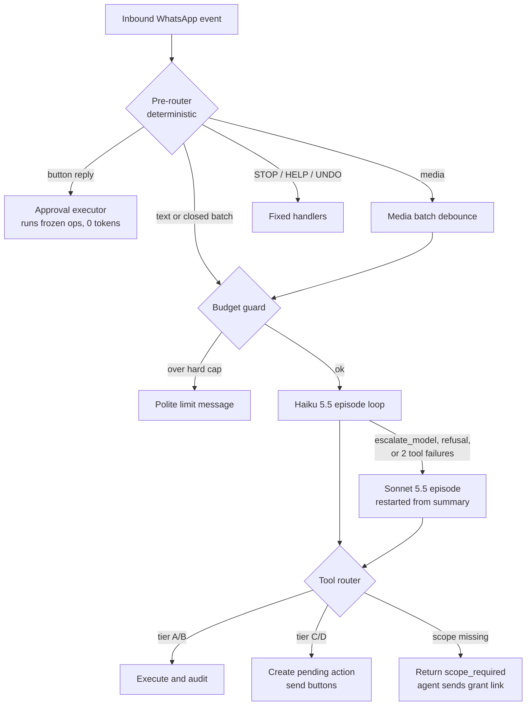

# 5. Agent Design: Loop, Routing, Prompt, Tools

- System prompt: [`agent/system-prompt.md`](../agent/system-prompt.md)
- Tool definitions with tiers and rungs: [`agent/tools.ts`](../agent/tools.ts)

## 5.1 Layers



## 5.2 Why we run our own loop on the Messages API

- **Approvals span WhatsApp turns.** A tier C call ends the turn, and the approval can arrive hours later as a
  button tap. We persist state and resume without an LLM call. Running the frozen operation directly is cheaper
  and safer than re-entering a model loop.
- **Per-merchant metering and budget checks** happen around every call.
- **Model choice per episode**: Haiku by default, Sonnet on escalation.
- Managed Agents was considered and rejected. It bills session runtime on top of tokens and starts a
  container per session, which doesn't fit ₹499/month. We need no sandbox for API tools.

## 5.3 Episode loop (TypeScript sketch)

```ts
import Anthropic from "@anthropic-ai/sdk";
import { toolsForShop, TOOL_INDEX } from "../../agent/tools";
import { SYSTEM_PROMPT } from "../../agent/system-prompt"; // loaded from the .md at build time

const client = new Anthropic(); // ANTHROPIC_API_KEY: a Claude Platform (Console) key, its own workspace + spend limit

const MODELS = { default: "claude-haiku-5-5", escalated: "claude-sonnet-5-5" } as const;
const MAX_TOOL_ROUNDS = 8;

export async function runEpisodeTurn(ep: Episode, userContent: Anthropic.ContentBlockParam[]) {
  await appendMessage(ep, { role: "user", content: userContent });           // append-only history
  const tools = toolsForShop(ep.shop.computerUseEnabled);
  const system: Anthropic.TextBlockParam[] = [
    { type: "text", text: SYSTEM_PROMPT, cache_control: { type: "ephemeral" } }, // tools+system: shared prefix
    { type: "text", text: renderMerchantContext(ep.shop) },                     // per-shop, after breakpoint
  ];

  for (let round = 0; round < MAX_TOOL_ROUNDS; round++) {
    await budgetGuard(ep.shop);                                               // throws BudgetExceeded
    const escalated = ep.model === MODELS.escalated;
    const params = {
      model: ep.model,
      max_tokens: 4096,                       // thinking counts toward this; keep headroom
      system, tools,
      messages: ep.messages,
      cache_control: { type: "ephemeral" as const },   // top-level auto-caching of the growing history
      thinking: { type: "adaptive" as const },
      output_config: { effort: ep.effort },  // "low" for chat routes, "medium" for store-config tasks
    };
    const res = escalated
      // Sonnet 5.5: server-side fallback if a safety classifier declines
      ? await client.beta.messages.create({ ...params, betas: ["server-side-fallback-2026-07-01"], fallbacks: "default" })
      : await client.messages.create(params);

    await logUsage(ep, res);                  // input, cache_read, cache_creation, output -> cost_usd

    if (res.stop_reason === "refusal") {      // Haiku 5.5 has no server-side fallback
      if (!escalated) return escalate(ep, "refusal");
      return replyText(ep, "I can't help with that request.");
    }
    await appendMessage(ep, { role: "assistant", content: res.content }); // keep thinking blocks unmodified

    if (res.stop_reason !== "tool_use") {     // end_turn / max_tokens
      return replyText(ep, textOf(res.content));
    }

    const calls = res.content.filter((b): b is Anthropic.ToolUseBlock => b.type === "tool_use");
    const results = await Promise.all(calls.map((c) => routeTool(ep, c))); // tiers, validation, audit
    await appendMessage(ep, { role: "user", content: results });          // all results in ONE user message

    if (results.some((r) => r.needsApproval)) {
      // Let the model write the one-line explanation, then stop; buttons are sent by the router.
      continue;
    }
    if (calls.some((c) => c.name === "escalate_model") && !escalated) return escalate(ep, "model_request");
  }
  return replyText(ep, "That took more steps than expected. I've saved progress. Reply *continue* to keep going.");
}
```

Key rules in the loop:

- **Read content blocks by `type`.** Haiku 5.5 responses can start with `thinking` blocks, whose text is
  empty by default. Pass them back unchanged.
- **History is append-only.** Never edit or remove earlier turns inside an episode. That keeps the cache valid,
  and Claude rejects replayed thinking blocks if earlier turns change. To shrink context, close the episode
  and start a new one whose first user message is a short summary.
- **Escalation starts a new episode on Sonnet** from a summary of the Haiku episode. It does not switch models
  in the middle of a loop, because caches are per model and thinking blocks are not shared across these models.
- **Missing-scope tool calls return** `{"status":"scope_required","grant_url":...}`, so the tool list stays the
  same for every merchant and the cache stays warm.

## 5.4 Model routing rules

| Signal | Route |
|---|---|
| Button reply, keyword, media upload | No model |
| Any other merchant text | Haiku 5.5, effort `low` |
| Router classifies the turn as store configuration (shipping, discounts, multi-product bulk) | Haiku 5.5, effort `medium` |
| Model calls `escalate_model`, Haiku returns `refusal`, two consecutive tool validation failures, or the merchant says "wrong" twice | New Sonnet 5.5 episode (at most 1 per episode, at most N per month by plan) |
| Listing copy | Haiku 5.5 `medium`. Sonnet 5.5 if the merchant turns on premium copy. |
| Daily abandoned-checkout drafts, weekly summary text | Haiku 5.5 `low`. Can use the Message Batches API (50% off) since nothing is waiting on the result. |

Tune these with the eval set (5.8) before launch. Effort is the first lever. Change models only where evals show a gap.

## 5.5 Listing generation (a single structured call, not an agent)

```ts
const listing = await client.messages.create({
  model: premium ? "claude-sonnet-5-5" : "claude-haiku-5-5",
  max_tokens: 4096,
  thinking: { type: "adaptive" },
  output_config: {
    effort: "medium",
    format: { type: "json_schema", schema: LISTING_SCHEMA }, // see below
  },
  system: [{ type: "text", text: LISTING_PROMPT, cache_control: { type: "ephemeral" } }],
  messages: [{ role: "user", content: [
    ...images768.map((b64) => ({ type: "image" as const, source: { type: "base64" as const, media_type: "image/jpeg" as const, data: b64 } })),
    { type: "text", text: `Store: ${shop.name}. Brand voice: ${shop.brandVoice ?? "plain"}. Merchant said: ${details}` },
  ]}],
});
```

`LISTING_SCHEMA` fields: `title` (≤ 70 characters), `description_html` (allowed tags `p`, `ul`, `li`, `strong`),
`seo_title` (≤ 60), `seo_description` (≤ 155), `tags` (≤ 12), `product_type`, `suggested_options`,
`images[] { index, role: packshot|lifestyle|detail, remove_background: bool, alt_text }`,
`assumptions[]` (shown to the merchant), `missing_info[]`.

## 5.6 Prompt caching layout

```
[tools (stable order)] [system prompt]  <- breakpoint 1: identical for every merchant (2 variants: CU flag)
[merchant context block]                  per shop: name, currency, timezone, plan, memory, recent episode summaries
[episode messages ...]                  <- top-level auto-cache breakpoint moves with the conversation
```

- Keep timestamps, ids and anything else that changes out of the system prompt. The current date goes in the merchant context block.
- Check `usage.cache_read_input_tokens` in `llm_usage`. Alert if the cache hit ratio for the shared prefix drops below 80%.
- Keep every Haiku request under 100K tokens. Above that the higher rate card applies. Episodes closing after
  30 minutes idle or about 40K tokens enforce this.

## 5.7 Cost controls

| Control | Default |
|---|---|
| Monthly LLM budget per shop | $2.50 (about ₹220). Soft limit at 80%: no escalation, no premium copy, no computer use. Hard limit: polite stop plus an add-on offer (usage charge). |
| Max tool rounds per turn | 8 |
| Max Sonnet episodes per month | 30 on the base plan |
| Images to vision | At most 6 per listing, downscaled to 768px |
| `max_tokens` | 4096 for the agent, 4096 for listings |
| Usage logging | Every call: `model`, `input_tokens`, `cache_read_input_tokens`, `cache_creation_input_tokens`, `output_tokens`, computed `cost_usd`, `purpose`, `episode_id` |
| Spend ceiling | A dedicated Claude Console workspace for production with an organization spend limit, so a runaway bug cannot drain credits |

## 5.8 Approvals, audit and undo

- The tool router turns tier C/D calls into a `pending_action` holding the exact GraphQL operations, variables,
  a before snapshot (read first) and a human-readable diff. The model never builds the button payload.
- On approval it checks the action is still pending and unexpired (24 h), that the approver is an owner for D
  (or for C if the merchant's settings require it), and that the before snapshot still matches (optimistic
  concurrency). Then it runs the operations, writes `audit_events` with before and after, and replies.
- Tier D also needs a second button ("Yes, delete 12 products").
- `UNDO` (keyword or tool) replays the before snapshot for reversible changes: product fields, prices,
  inventory, banner, shipping rates, discounts (deactivate). Deletion cannot be undone, which is why the agent
  prefers archive.
- The embedded admin shows the audit log, pending approvals and approval rules (for example "auto-approve price
  changes under 5%").

## 5.9 Evaluation before launch

- Build 60 scripted merchant conversations in English, Hindi and Hinglish: product creation with messy photos,
  vague price changes, shipping thresholds, banners, abandoned checkouts, prompt injection in product data,
  and out-of-scope requests (payments, domains).
- Grade on: correct tool and rung chosen, approval correctly required, no fabricated claims in copy, response
  length, tokens per completed task.
- Run them in CI against a development store with recorded fixtures, and against the live API weekly.
- These conversations also give the tokens-per-task numbers behind the cost model.
