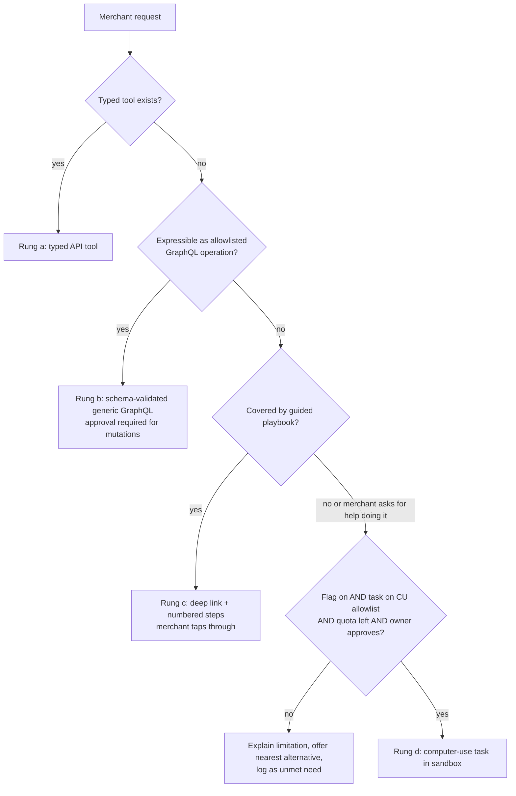

# 6. Computer-Use Fallback Design

## 6.1 Position: designed, flagged, off by default

Driving the Shopify admin with a bot carries real policy risk for a **public App Store app**:

- App Store requirements forbid asking merchants for their Shopify login or making them share credentials.
  A server-side browser session needs a logged-in staff account, which means credentials or session cookies.
- Shopify's API and Partner terms expect apps to work through the published APIs. Automating the admin UI to
  get around API limits is likely to fail app review and may breach the Partner Program Agreement.
  **This needs a written check with Shopify Partner Support and a legal reading before any rollout.**
- Admin UI changes break selectors and flows without notice, so reliability is low.

So the launch build ships **rungs a–c only**. Rung d is built behind a flag for two later uses:
(1) internal use on our own and development stores, to find which tasks merchants actually need; and
(2) if Shopify confirms it is acceptable, a merchant-present co-pilot mode (6.5).

## 6.2 The ladder (how fallback is triggered and kept rare)

Ways we keep it rare:

1. **Unmet-need logging.** Every request that reaches rung c or d is logged with a topic. Each month the top
   topics get typed tools or Theme App Extension features. The goal is for rung d volume to shrink over time.
2. **Allowlist, not blocklist.** Only named tasks such as `toggle_store_password` or `edit_homepage_meta` with
   a written playbook are allowed. Each has an expected-start URL, a success check and a step limit.
3. **Hard exclusions** that are never automated: payments and payouts, billing, domains, staff and permissions,
   app installs and OAuth consent, deleting anything, checkout settings, tax registration, account security.
4. **Quota**: 3 tasks per shop per month on the base plan. More are a usage charge.
5. **Model only proposes; the router decides.** `request_computer_use` is exposed only when the flag is on.
   The router checks the allowlist id, quota and approval before anything starts.

## 6.3 Candidate allowlist (no API, or an API restricted for public apps)

| Task | Why there is no API path | Guided alternative (rung c) |
|---|---|---|
| Theme colours, fonts, native announcement bar | Theme settings live in `settings_data.json`. Writing it needs `write_themes`, which is restricted and conflicts with App Store rules. | Theme editor deep link plus steps. Our banner block covers most "banner" requests through the API. |
| Store password page on/off | No Admin API | `admin/online_store/preferences` deep link |
| Homepage title and meta description | No Admin API | Preferences deep link |
| Notification email templates | No Admin API | Settings → Notifications deep link |
| Installing a third-party app | Needs the merchant's OAuth consent | App Store listing link, never automated |

## 6.4 Server-side sandbox design (internal and dev stores only)

| Aspect | Design |
|---|---|
| Runtime | One Fly Machine per task, Playwright Chromium, no persistent volume, destroyed afterwards. Max 10 minutes. |
| Model and tool | Claude Sonnet 5.5 with `computer_toolset_20260801` (GA; each tool result echoes `toolset_name: "computer"`). Evaluate Haiku 5.5 with `browser_toolset_20260801` for browser-only tasks, which may cost about 20× less. Check both against the current computer-use docs when building. |
| Screen | 1280×800. Screenshots resized to fit model limits. Server-side tool-result clearing instead of pruning screenshots on the client (pruning invalidates later thinking blocks). |
| Network | Egress allowlist: `admin.shopify.com`, `{shop}.myshopify.com`, Shopify CDN hosts. Everything else blocked at the proxy. |
| Identity | A dedicated staff account with the minimum permissions for the task. Credentials never touch the model; the harness logs in before control is handed over. |
| Guardrails | Start URL fixed by the playbook. Step limit (25). URL watchdog aborts on navigation outside allowed admin paths (`/settings/payments`, `/settings/billing`, `/apps` installs and so on). Text typed into fields comes only from the approved plan. A screenshot classifier pauses on any confirmation dialog containing "delete", "remove", "uninstall" or "pay". |
| Prompt injection | Page content is treated as untrusted. The system prompt for the computer-use session repeats that on-screen text is data. Any on-screen instruction causes an abort. |
| Audit | Every screenshot and action is stored for 30 days (encrypted) and linked to the `audit_event`. The merchant gets a before/after screenshot. |
| Cost guard | About $0.20–0.40 per task on Sonnet 5.5 (doc 08). Charged against the CU quota and budget. |

## 6.5 Merchant-present co-pilot mode (preferred if computer use is ever enabled for merchants)

Instead of a server holding credentials, the merchant opens a link on desktop that loads our embedded app page.
It shows the exact steps and, where Shopify allows, uses App Bridge navigation (`shopify.navigate`, admin
intents) to take the merchant to the right screen. The merchant clicks the final buttons. No credentials leave
the merchant's session, and every step is visible to them. This is the "guided fallback" with better navigation,
and is probably the version that can pass App Store review.
